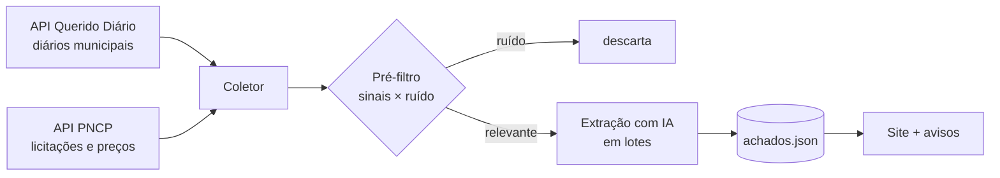

# Cão de Guarda · dinheiro público para cães e gatos, achado nos Diários Oficiais

`PROTÓTIPO` · Projeto social. O coletor de exemplo está neste repositório.

> *EN: Civic-tech robot that reads municipal Official Gazettes (Querido Diário API) and public procurement data (PNCP) to surface free neutering programs, pet food grants and NGO funding that nobody sees.*


**🔗 Site:** [Cão de Guarda](https://claude.ai/artifact/5gwdPmgob1LBe9R7rQPy1L)

---

## O problema

Castração de graça, ração para protetores e dinheiro para ONGs existem, mas são publicados nos **Diários Oficiais**, no meio de centenas de páginas sobre aposentadoria, pneus e licitação de merenda. Quem cuida dos animais não tem tempo de ler isso, e o prazo vence sem ninguém se inscrever.

## A solução

Um robô que lê os diários de todas as cidades de um estado, separa o que importa e transforma em aviso simples: **o que é, até quando e como se inscrever.**



## Achados reais (Bahia, 2025–2026)

- **R$ 1,2 milhão+** em ações de proteção animal publicadas em um ano, espalhadas em centenas de diários
- **7 credenciamentos de castração** abertos em 6 cidades ao mesmo tempo
- Preço contratado de castração variando de **R$ 166,77 a R$ 624** entre prefeituras (mesmo serviço)
- Salvador com edital aberto para ONGs (captura, castração e devolução) e chamamento de ração para protetores
- **126 ONGs** de proteção animal ativas na Bahia mapeadas por CNAE na base da Receita

## Decisões técnicas

| Desafio | Como resolvi |
|---|---|
| Muito ruído na busca por "animal" | Pré-filtro por regex: precisa de 2+ sinais (castração, edital, OSC, valor) e nenhum termo de ruído (vaquejada, merenda…) |
| Cota gratuita de IA baixa | IA só nos trechos que passaram no filtro, em lotes, com retomada de onde parou |
| Preço de castração "sujo" na licitação | Itens e resultados homologados do PNCP, tirando kit, internação e instrumentos da conta |
| Número sem prova | Todo achado leva o link do diário original |

## Rodar o coletor

```bash
python3 coletor/coletar.py --cidade 2927408 --dias 90   # Salvador
python3 coletor/coletar.py --uf BA --dias 30            # Bahia inteira
```

Sem dependências além do Python 3. Gera `achados.json` com cidade, data, motivo, trecho e link do diário.

## Stack


---

Projeto de [Leonardo Magalhães](https://github.com/leomagalhaesti) · dados públicos do [Querido Diário](https://queridodiario.ok.org.br) (Open Knowledge Brasil) e do [PNCP](https://pncp.gov.br).
